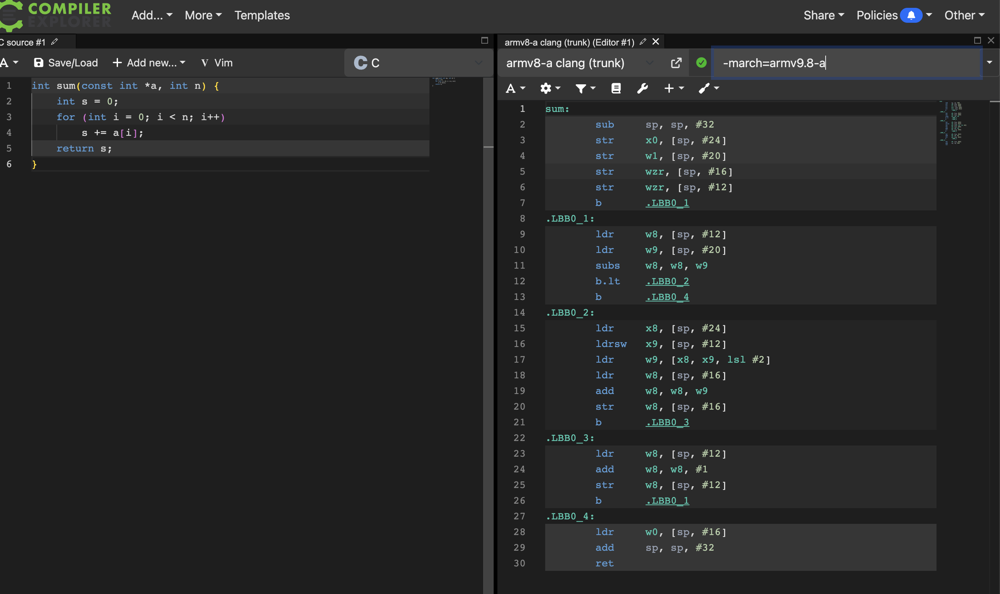

# Arm MCP Server lab

Exploring Arm's official MCP server (github.com/arm/mcp) by calling its
tools directly, with no AI assistant in the loop, then checking the
results against the source code.

## What I ran
- `armlimited/arm-mcp:latest` (arm64 image) on an Apple Silicon Mac
- Listed its five tools via MCP Inspector v2.10.1 over stdio
  (knowledge_base_search, check_image, skopeo, migrate_ease_scan, mca)
  and tested mca in depth
- Main focus: the `mca` tool (llvm-mca), comparing a simple C loop
  compiled at `-O0` and `-O2` with armv8-a clang 19.1.0

## Setup
1. `docker pull armlimited/arm-mcp:latest`, then confirmed `arm64`
   with `docker image inspect`
2. `npx @modelcontextprotocol/inspector`, then added a stdio server:
   `docker run --rm -i -v <project>:/workspace armlimited/arm-mcp:latest`
3. Generated AArch64 assembly on Compiler Explorer and saved it in `samples/`

## Findings

### 1. The `mca` tool's `triple` field always fails
Setting `triple` returns `status: error` with
`llvm-mca: Unknown command line argument '--triple'`.
The `cmd` field in the response shows why: the server passes `--triple`,
but llvm-mca's flag is `--mtriple`
(`mcp-local/utils/llvm_mca_tool.py`, line 26).
Workaround: leave `triple` empty and pass `["--mtriple=aarch64"]` in `extra_args`.

### 2. The bundled llvm-mca can't model Neoverse V3
`cpu: neoverse-v3` fails: "'neoverse-v3' is not a recognized processor".
The image installs LLVM 18, which predates V3 support. V3 is the core in
Arm's AGI CPU, so the tool can't currently model Arm's newest server core.
I used `neoverse-v2` instead.

### 3. Measuring the whole function gives a misleading answer
| Comparison | -O0 | -O2 | Result |
|---|---|---|---|
| Whole function | 474 cycles | 403 cycles | -O2 looks ~15% faster |
| Loop body only, per number added | 3.08 cycles | 0.26 cycles | **-O2 ~12× faster** |

llvm-mca ignores branches and runs every line once per pass. The -O2 code
has a vector loop that adds 8 numbers per pass, plus extra setup and a
leftover loop, so whole-function numbers hide the real gain.
Comparing only the loop bodies, per number added, gives a fair test.

## What surprised me
IPC went **down** (5.19 → 2.87) while the code got ~12× faster per number.
At -O0 the CPU is busy moving values to and from memory (load/store units
were the bottleneck). At -O2, one `add v0.4s` instruction does four
additions, so fewer instructions do far more work. IPC measures how busy
the CPU is, not how much useful work it does.

## Other observations
- Calling `mca` with no `input_path` returns `status: ok` with llvm-mca's
  help text, so an AI agent could treat it as a successful analysis
- Every tool takes an `invocation_reason` field so the calling model can
  record why it chose the tool
- llvm-mca assumes by default that loads and stores never depend on each
  other, which flatters the -O0 code. The real gap is probably larger
- Compiler Explorer: armv8-a clang 22.1.0 was the first release to accept
  `-march=armv9.7-a`; clang trunk accepted `-march=armv9.8-a` (10 Oct 2026)

## What I'd try next
- Report the `triple` bug to the arm/mcp repository
- Re-run the comparison with llvm-mca's memory-dependency modelling on
- Try the same analysis on a real loop from one of my own projects
